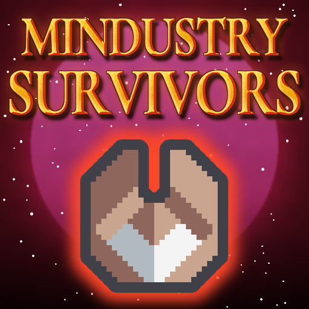
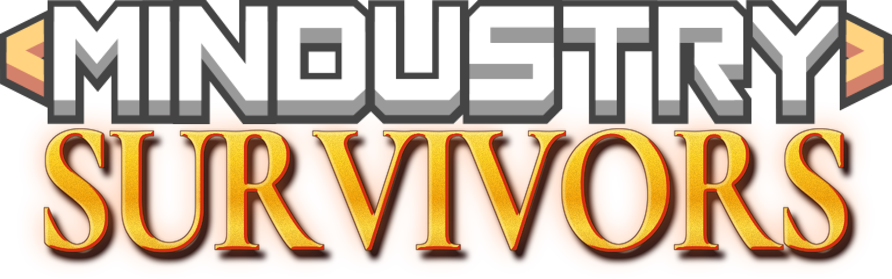

  
   
  

Mindustry, but you play it like Vampire Survivors.

## Install

- **Easiest:** in the game, open **Mods**, press **Mod Browser**, search for Mindustry Survivors and install it.
- **If it's not there:** in **Mods**, press **Import From GitHub** and type `kennyzhang0819/mindustry-survivors`.
- **By hand:** download `MindustrySurvivors.jar` from [Releases](https://github.com/kennyzhang0819/mindustry-survivors/releases), then in **Mods** press **Open Folder** and drop it in.

Restart the game after installing.

## How to play

Press **Mindustry Survivors** on the main menu, pick a difficulty and hit **New Game**.

- Survive 50 waves on a random map. Enemies chase you from every side.
- Kill enemies and pick up their gems to level up.
- Turrets orbit you and fire with you.
- Up to 6 passives boost you.

## Difficulty and settings

- Easy, Normal, Hard and Eradication change how many enemies show up (you level up about as fast on all of them). Eradication +1 to +3 add curses, random nasty rules for the enemies.
- In **Settings** you pick which turrets and enemies you get (Serpulo, Erekir or both).
